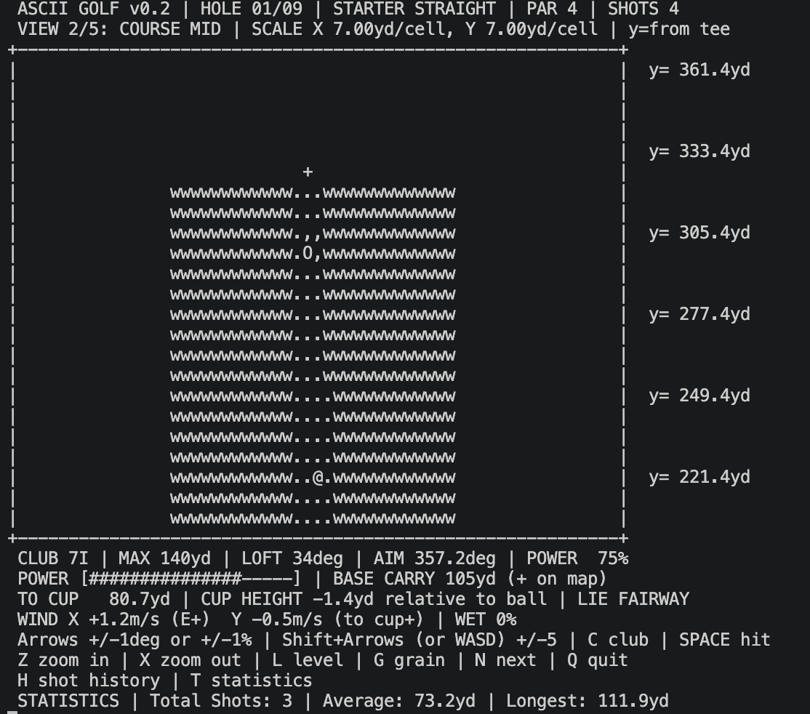

# ⛳ ASCII GOLF 改良版

### 狙って、打って、ベストスコアを目指そう！


---

## 🎮 ゲーム概要

ASCII GOLFは、Pythonで作られた、
ターミナル上で楽しめるレトロスタイルの
ゴルフゲームです。

クラブ、ショットの方向、パワーを調整しながら、
少ない打数でホールクリアを目指しましょう！

シンプルな操作で楽しめますが、
風や地形、ショットの正確さを考える必要があり、
戦略性のあるゲームになっています。

今回の改良版では、既存のゲームに
3つの新しい機能を追加しました。

**あなたは何打でクリアできるでしょうか？**

---

## 📸 ゲーム画面

### 難易度選択画面


### プレイ統計画面



---

## ✨ ゲームの特徴

- レトロなASCIIグラフィック
- シンプルなキーボード操作
- 3段階の難易度選択
- クラブとパワーの調整
- 風や地形を考えた戦略的なプレイ
- ショット履歴の確認
- プレイ結果の統計分析
- 外部ライブラリのインストール不要

---

## 🆕 追加・改良した3つの機能

### 1. 🎯 難易度選択機能

ゲーム開始時に、3種類の難易度から
自分に合ったレベルを選択できます。

| 難易度 | 特徴 | 方向のばらつき |
|---|---|---|
| 🟢 Easy | 初心者向け | 0.5倍 |
| 🟡 Normal | 標準モード | 1.0倍 |
| 🔴 Hard | 上級者向け | 1.5倍 |

難易度に応じてショットの方向のばらつきが
変化するように改良しました。

初めてプレイする方はEasyモードから
挑戦してみてください！

### 2. 📝 ショット履歴機能

Hキーを押すと、直近5回のショット履歴を
確認できます。

記録される情報：

- ホール番号
- ショット番号
- 使用したクラブ
- ショットのパワー
- 飛距離

過去のショットを振り返りながら、
次のショットの戦略を考えることができます。

### 3. 📊 プレイ統計機能

Tキーを押すと、自分のプレイ結果を
数値で確認できます。

表示される情報：

- ショット回数（Total Shots）
- 平均飛距離（Average Distance）
- 最大飛距離（Longest Distance）

表示例：

```text
STATISTICS
Total Shots: 3
Average: 73.2yd
Longest: 111.9yd
```

自分のプレイを分析しながら、
より良い記録を目指すことができます。

---

## 🚀 ダウンロード・実行方法

### 必要な環境

- Python 3
- ターミナル
- Git（cloneを使用する場合）

開発・動作確認にはPython 3.14を使用しました。

### 方法1：Gitを使用する場合

ターミナルで以下のコマンドを実行してください。

```bash
git clone -b original-version https://github.com/ArwenRose/w14_ASCII_GOLF.git
cd w14_ASCII_GOLF
python3 ascii_golf.py
```

### 方法2：ZIPファイルを使用する場合

1. GitHubの「Code」ボタンをクリックします。
2. 「Download ZIP」を選択します。
3. ZIPファイルを展開します。
4. ターミナルで展開したフォルダを開きます。
5. 以下のコマンドを実行します。

```bash
python3 ascii_golf.py
```

ゲームが起動したら、難易度を選択して
プレイを開始してください。

---

## 🕹️ 操作方法

| キー | 操作 |
|---|---|
| ← / → | 方向の微調整 |
| ↑ / ↓ | パワーの微調整 |
| A / D | 方向調整 |
| W / S | パワー調整 |
| C | クラブ変更 |
| SPACE | ショット |
| H | ショット履歴 |
| T | プレイ統計 |
| Z | ズームイン |
| X | ズームアウト |
| L | 高低差表示 |
| G | 芝目表示 |
| N | 次のホール |
| Q | ゲーム終了 |

---

## 💡 プレイのコツ

- カップまでの距離に合わせてクラブを選びましょう。
- パワーを調整して飛距離をコントロールしましょう。
- 風向きや地形にも注意しましょう。
- Hキーで過去のショットを確認しましょう。
- Tキーで自分のプレイ結果を分析しましょう。

---

## 🏆 チャレンジ

自分なりの目標を設定して挑戦してみましょう！

- 🟢 Easyモードでホールクリアを目指す
- 🟡 Normalモードで少ない打数を目指す
- 🔴 Hardモードでホールクリアに挑戦する
- 📈 最大飛距離の自己記録を更新する
- 🎯 ショット履歴を活用してプレイを改善する

---

## 💻 開発環境

| 項目 | 使用技術 |
|---|---|
| OS | macOS |
| 言語 | Python 3.14 |
| エディタ | Visual Studio Code |
| バージョン管理 | Git |
| 公開サービス | GitHub |

---

## 🛠️ 開発で工夫した点

既存のプログラムを活用しながら、
ゲームの操作性や楽しさを向上させるために、
3つの機能を追加しました。

特に、ショット履歴のデータを再利用して、
平均飛距離や最大飛距離を計算できるようにしました。

また、難易度によってショットの正確さを変化させ、
初心者から上級者まで楽しめるように工夫しました。

Gitを使用して変更履歴を管理し、
機能の追加や修正内容をコミットとして記録しました。

---

## 🌱 今後の改善予定

今後は、以下の機能の追加も検討しています。

- ハイスコア保存機能
- ランキング機能
- 新しいゴルフコース
- プレイ結果のCSV出力
- グラフィックの改善

※ 上記は今後のアイデアであり、現在は未実装です。

---

## 👩‍💻 開発者

**ArwenRose**

Python / AI / Data Science

既存のASCII GOLFをベースに、
学習目的で機能の追加・改良を行いました。

---

## ⭐ Enjoy the Game!

ゲームを楽しんでいただけたら、
GitHubのStarで応援していただけると嬉しいです。

**Choose your club. Take your shot. Beat your best score!**

⛳ Happy Golfing!